# LEVEL 1 REPORT (Electronic Design)
## Task 1: Engineer’s Swiss Army Knife
I set up my MathWorks account, installed MATLAB, and successfully completed the MATLAB Onramp certification course.
To complete the MATLAB Onramp certification, I applied core fundamentals—including array manipulations, function calls, plotting, and data import I learnt from the start — to a final project on Stellar Motion. In this project, I processed spectral data in MATLAB to measure Doppler shifts and automatically compute the relative velocities of distant stars.

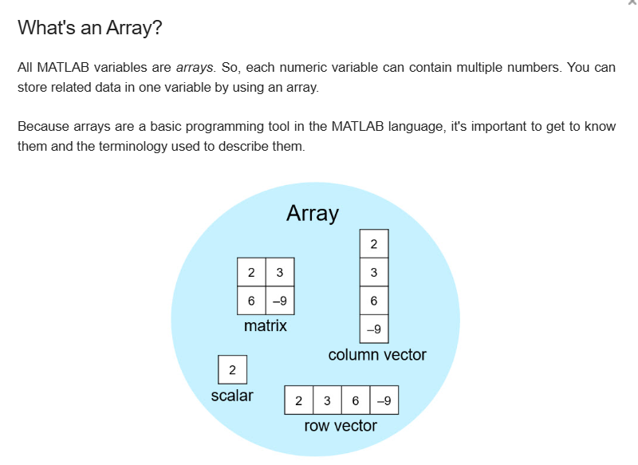
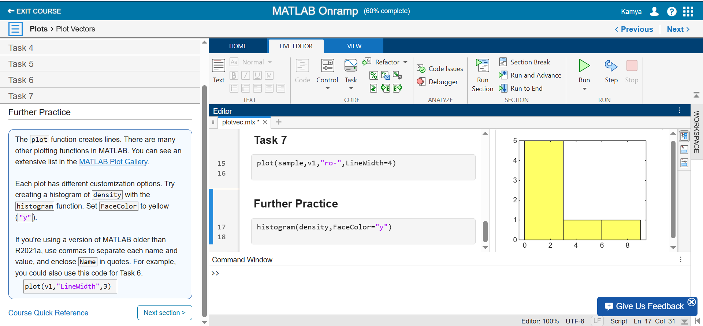
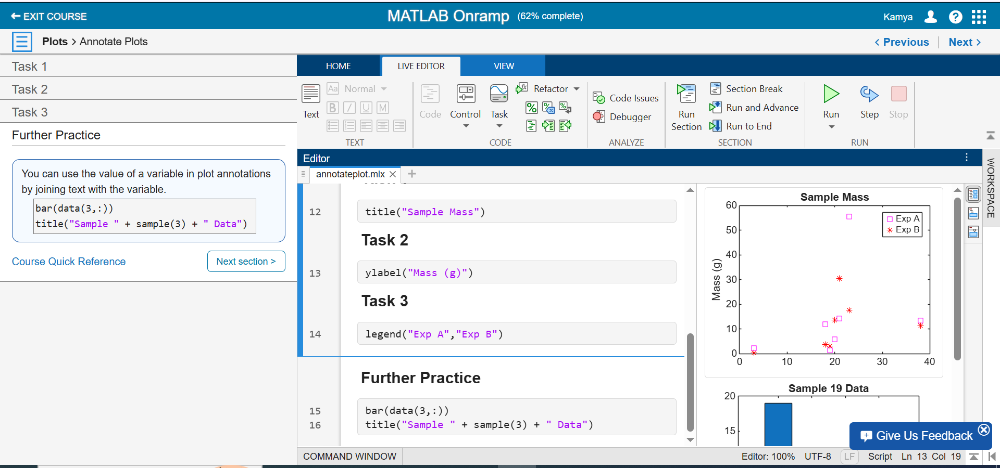
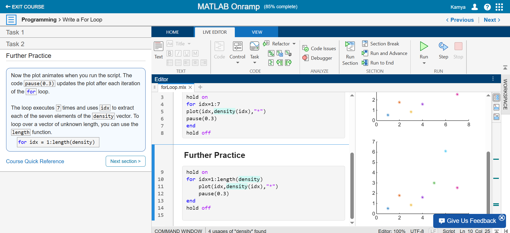
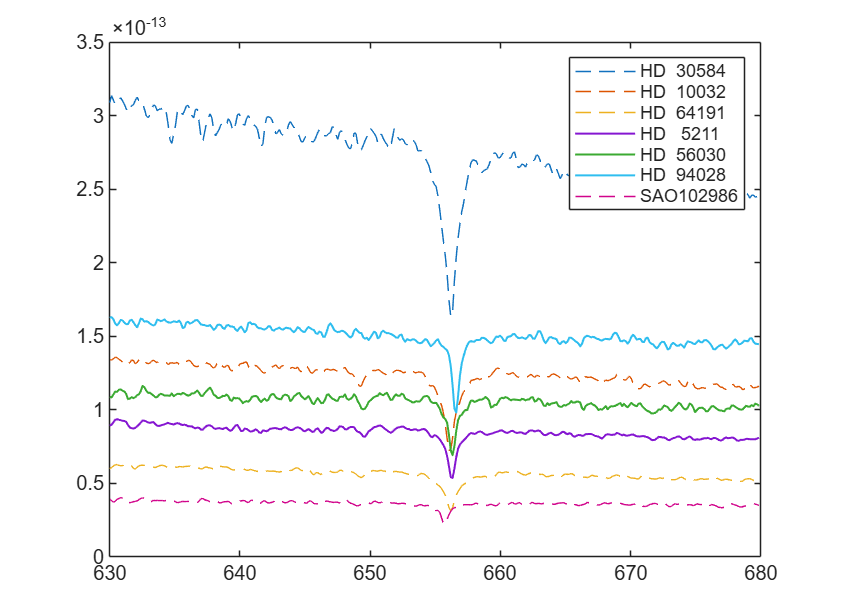
### Certificate:
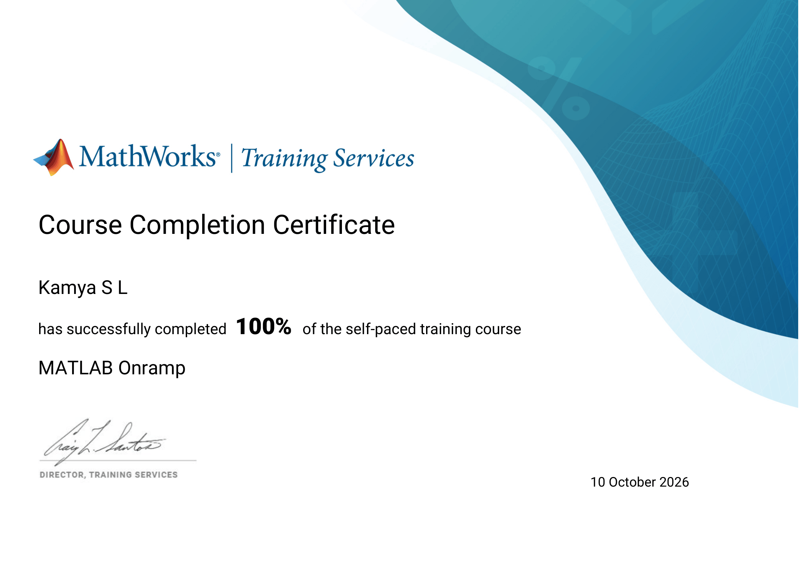

## Task 2: Cut, Pass, Repeat
*Objective:*
To design a second-order active Sallen-Key band pass filter using an OpAmp in LTspice that amplifies the signal by $1.5\times$ ($\approx 3.52\text{ dB}$) with a cutoff range between $4\text{ kHz}$ and $10\text{ kHz}$.

*Methodology:*
I first learnt about the second-order bandpass filter and tried designing it by cascading a low-pass filter and a high-pass filter. However, this initial circuit couldn't meet the required specifications. After further research, I selected the Sallen-Key bandpass filter topology.

I designed the circuit using $R_1 = 2.65\text{ k}\Omega$, $R_2 = 6.36\text{ k}\Omega$, $R_3 = 5\text{ k}\Omega$, $R_4 = 10\text{ k}\Omega$, $R_5 = 1.59\text{ k}\Omega$, and $C_1 = C_2 = 10\text{ nF}$. I then constructed the schematic in LTspice and ran an AC analysis (.ac dec 100 100 100k) to simulate and verify the frequency response.   

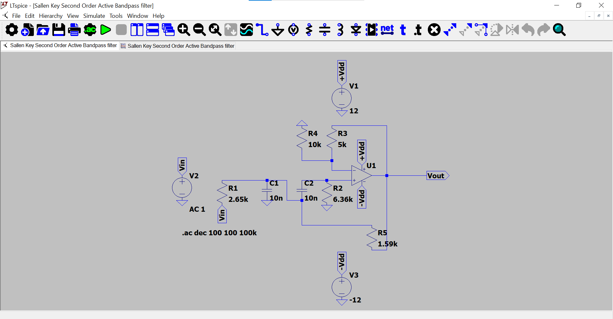

A second-order Sallen-Key active bandpass filter uses $RC$ networks to define response limits while an OpAmp provides active gain. The high-frequency cutoff is set by $R_1 C_1$, the low-frequency cutoff is set by $R_2 C_2$, and the feedback resistors set the passband gain to:
   $$A_v = 1 + \frac{R_3}{R_4} = 1 + \frac{5\text{k}}{10\text{k}} = 1.5 \quad (\approx 3.52\text{ dB})$$

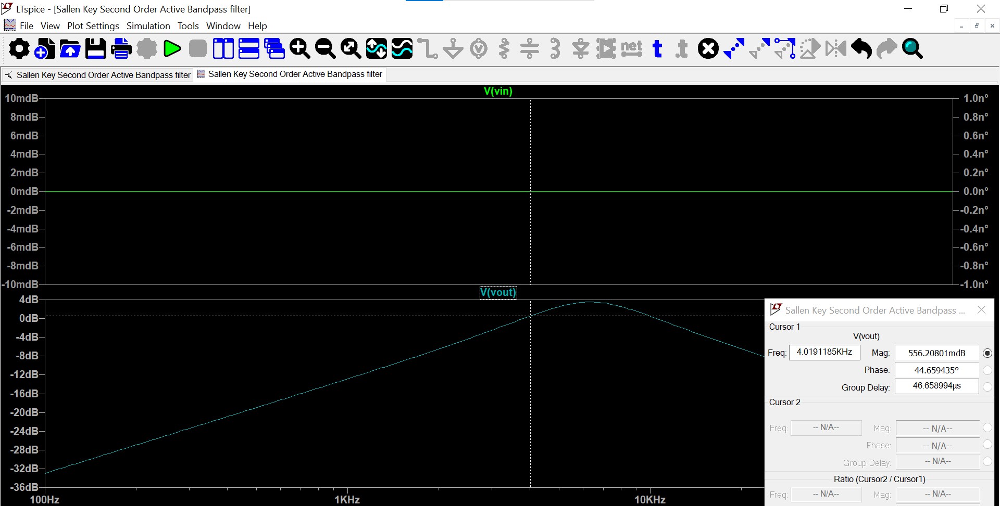

Outcome:
Learnt about second-order Sallen-Key bandpass filters and verified the gain and cutoff specs via LTspice simulation.

## Task 3: SPICEy Code

*Objective:*
To learn SPICE code implementation and simulate a CMOS Inverter, AND Gate, and OR Gate using LTspice.Methodology.

I constructed and simulated the digital logic circuits in LTspice using both device-level MOSFET structures and behavioural logic elements:   
* CMOS Inverter:CMOS Inverter: Inverts the input signal—when the input is High, the output goes Low, and when the input is Low, the output goes High.  

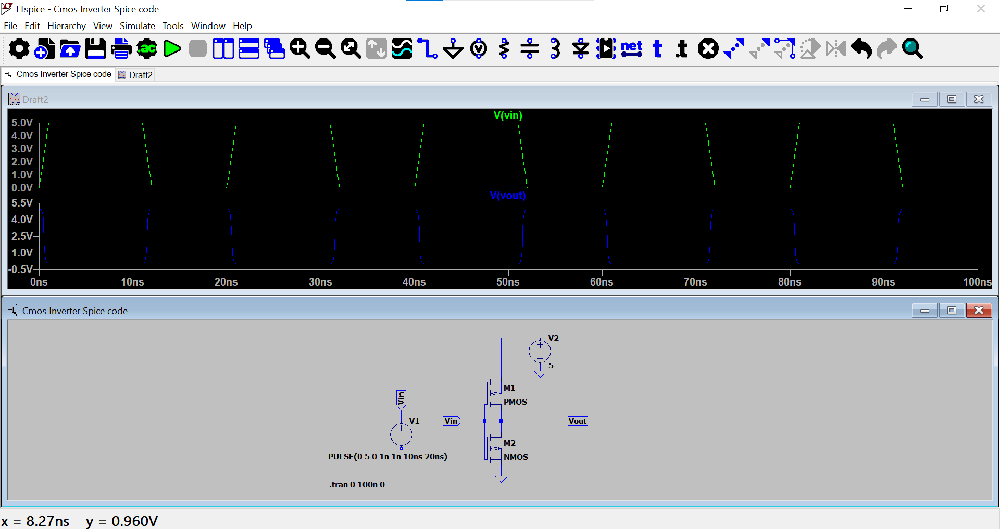

* AND Gate: Output is High only when both inputs are High.   
* OR Gate: Output is High when at least one input is High.

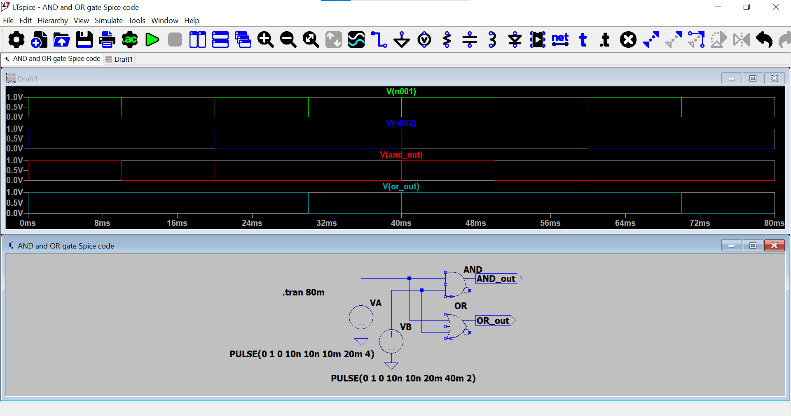
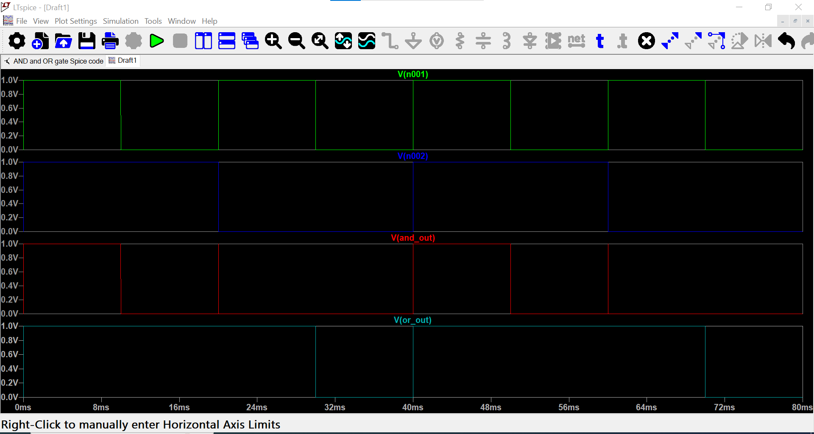
The red line is mostly flat at 0 V with a few thin spikes because the inputs aren't clean square waves, so the AND gate only gets both inputs high for an instant.

*Outcome:*
Successfully implemented and verified the transient operation and truth tables for the CMOS Inverter, AND, and OR gates in LTspice.


## Task 4: From Low to Woah!
### 1. 555 Timer Circuit

The first stage of the project uses a **NE555 timer IC** to generate a continuous square-wave signal from the 9 V DC supply. The 555 timer is configured in **astable mode**, where it continuously charges and discharges its timing capacitor, producing a periodic square wave at the output. The selected values of Ra = 1k ohm, Rb = 10k ohm, and Ct = 4.7nF produce a frequency of approximately **15 kHz**. This switching signal is required for the voltage multiplier because the capacitors need repeated charging and discharging cycles to transfer and pump electrical charge.

The transient simulation initially shows a short startup period as the timing capacitor charges from its initial state. After this transient, the output settles into a stable square wave of approximately **0–9 V** at around **15 kHz**. This output is then used as the switching input for the voltage multiplier stages.

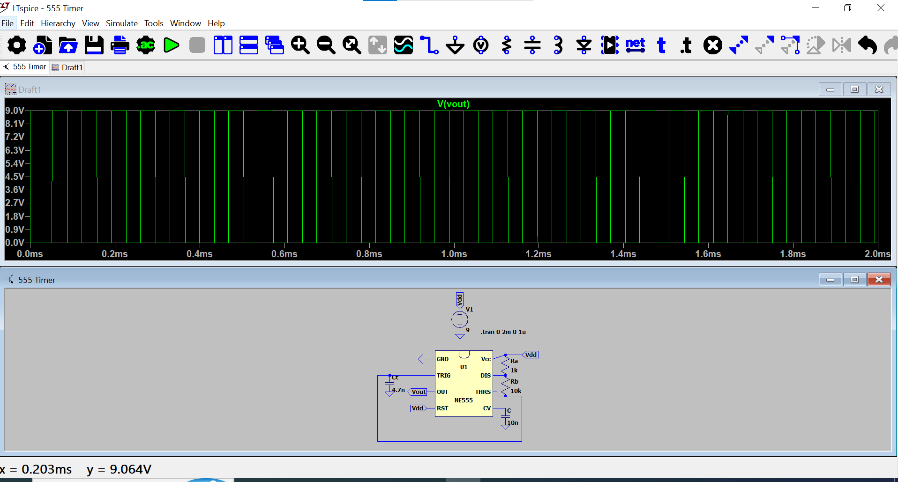

**Figure 1: 555 Timer configured as an astable oscillator producing a ~15 kHz square wave.**

---

### 2. Voltage Doubler

The second stage uses the square-wave output from the 555 timer to implement a **diode-capacitor voltage doubler**. The circuit consists of two 1N5819 Schottky diodes and two 10 µF capacitors. The switching waveform repeatedly charges the pump capacitor and transfers the stored charge through the diodes to the output capacitor. In this way, the voltage obtained from the 9 V source is increased beyond the original supply voltage.

During the simulation, the output capacitor gradually charges from 0 V and settles at approximately **17.5 V**. The output is slightly lower than the ideal 18 V because of practical losses such as the forward voltage of the diodes and the non-ideal output of the 555 timer.

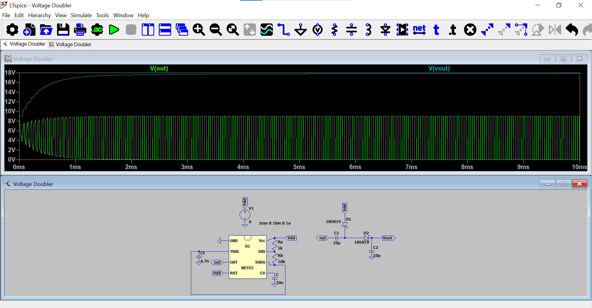

**Figure 2: Voltage doubler using diode-capacitor charge pumping, producing approximately 17.5 V from the 9 V supply.**

---

### 3. Voltage Tripler

The final stage is obtained by cascading a second diode-capacitor charge-pump stage with the voltage doubler. Two additional 1N5819 diodes and two 10 µF capacitors are used for the second stage. The switching signal from the 555 timer continues to drive the charge-pump operation, while the first multiplier stage provides the increased voltage level for the next stage.

The simulated output of the cascaded circuit reaches approximately **26 V**, compared with the ideal target of 27 V. The difference is mainly due to diode voltage drops and circuit losses. Thus, the complete system demonstrates the conversion of a **9 V DC input into approximately 26 V DC** using a 555 timer and cascaded diode-capacitor voltage multiplier stages.

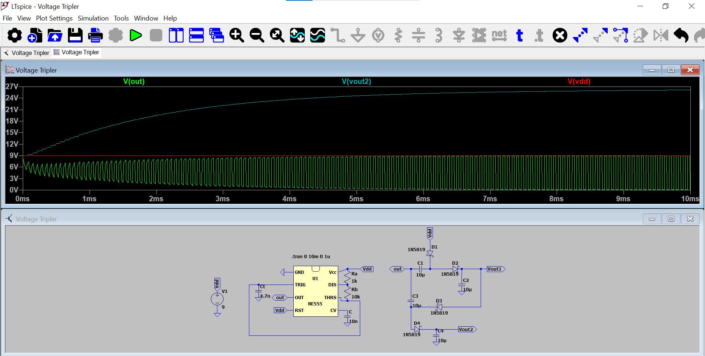

**Figure 3: Cascaded voltage multiplier producing approximately 26 V from the 9 V input.**

## Task 5: The Power Shuffle: Buck-Boost Edition
*Objective:*
To learn about the DC-DC Converters (Boost and Buck converters) and perform the following: Build a 1.5V to 5V DC-DC Boost converter Build a 12V to 5V DC-DC Buck converter

*Methodology:*
I first read upon the basics of the DC-DC Converters (Boost and Buck converters). I then created the circuit schematic of a 1.5V to 5V DC-DC Boost converter using LTspice and then simulated it to perform a transient analysis and observe the waveforms of the input and output voltages (vs time). I repeated the same for a 12V to 5V DC-DC Buck converter.

A buck converter and a boost converter are DC–DC converters used to change one DC voltage level to another using high-speed switching along with an inductor, diode (or switch), and capacitor. 
- A buck converter reduces (steps down) the input voltage to a lower output voltage by rapidly turning the supply on and off and smoothing it to a steady lower value. 
- A boost converter increases (steps up) the input voltage to a higher output voltage by storing energy in an inductor when the switch is on and releasing that energy to the load when the switch is off.

Boost Converter
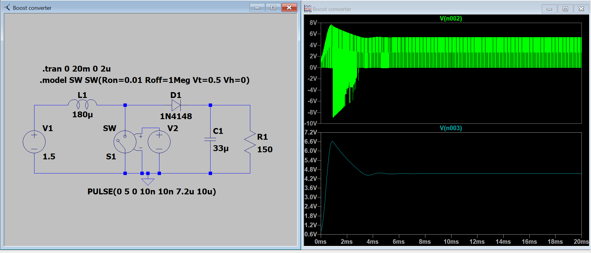

A Schottky diode gives higher output and better efficiency than a normal silicon diode, because its forward drop is lower.

Buck Converter
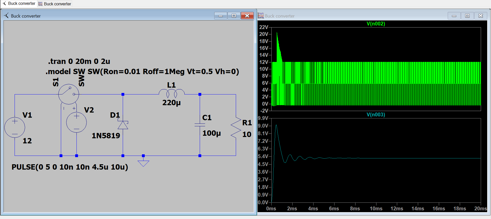

## Task 6: 4 Bits to Rule Them All
*Objective:*
To design and implement a 4-bit Arithmetic Logic Unit (ALU) in CircuitVerse that performs addition, subtraction (using 2’s complement) and the logical operations AND, OR and XOR, along with inversion (NOT) of the inputs as a bonus. The aim was also to design a control unit that selects the required operation based on input signals, and to display the result along with the carry flag. The design should be efficient in gate usage and easy to extend to more bits.

*Methodology:*
For this task, I started by designing a full adder circuit first and used four of them in a chain to make a 4-bit ripple-carry adder, where the carry of each stage feeds the next stage.

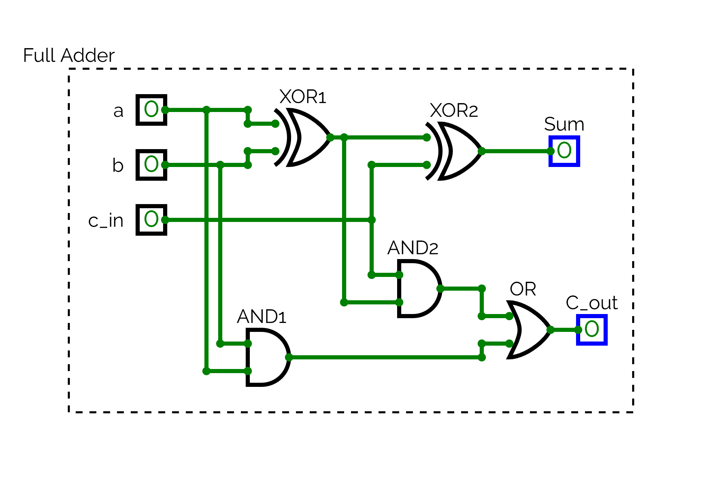

To add subtraction, I placed an XOR gate in front of each bit of input B, with a Mode (M) input as the second input of every XOR gate. When M = 0, B passes unchanged and the circuit adds A + B. When M = 1, B is inverted, and M is also given as the carry-in of the first adder, so the circuit computes A + (NOT B) + 1, which is the 2’s complement subtraction A − B. This way, one adder performs both addition and subtraction.
Further, I implemented logical operations like: AND, OR, XOR and also negation/inversion with the same 4-bit inputs.Finally I integrated them all using a MUX to get the required output.

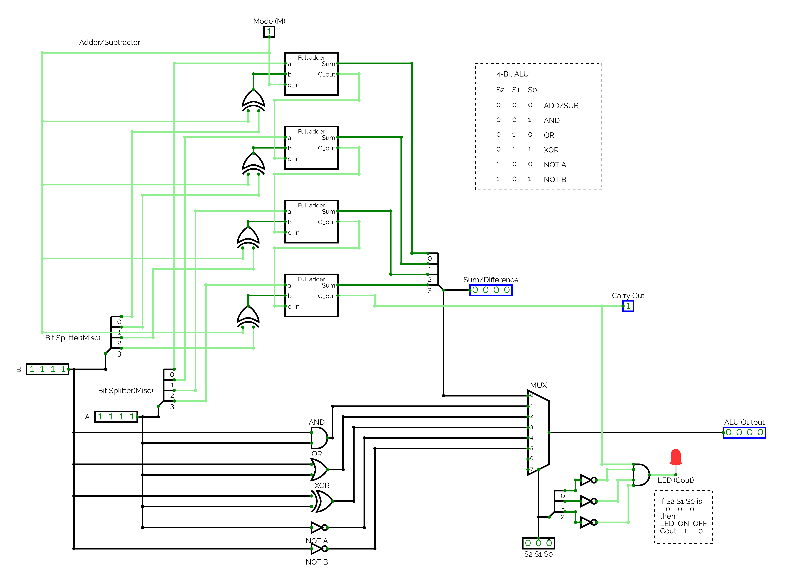

The carry-out of the adder is displayed, and an LED is lit through an AND gate only when the carry is 1 and S2 S1 S0 = 000, since the carry is meaningful only for add/subtract. I tested the circuit with different values of A, B, M and the select lines to verify each operation.

## Task 7: The PCB Revolution

## Task 8: Convolution Countdown
In this task i learnt about the basis of Digital Signal Processing (DSP)and learnt to perform convolution operation in MATLAB. 

Digital Signal Processing (DSP) involves analysing and processing signals using mathematical operations and computers. Signals carry information and can represent sound, images, voltage measurements or communication data.

A **discrete-time signal** is represented as a sequence of values indexed by integers. A **system** takes an input signal, processes it and produces an output signal. DSP techniques help us understand how signals behave and how systems modify them.

Two important mathematical tools used in DSP are the **Fourier Transform**, which helps analyse the frequency components of a signal, and the **Z-Transform**, which is used to study discrete-time signals and systems mathematically.

### What Is Convolution, and Why Do We Need It?

Convolution is a mathematical operation used to calculate the output of a linear time-invariant (LTI) system when its input signal and impulse response are known.

Imagine clapping twice in a room. The first clap creates sound, and the room reflects that sound, producing echoes. Before the first echo disappears, the second clap occurs and creates another set of echoes. At certain moments, the effects of both claps overlap.

The sound heard at any moment is the combined effect of the original sounds and their echoes. **Convolution provides a mathematical method to calculate this combined output.**

This concept is useful in audio processing, noise filtering, communication systems and image processing.

Convolution can be understood through a simple echo example:
- Imagine clapping twice in a room. Each clap produces sound and echoes that may overlap.
- The sound heard at any moment is the combined contribution of both claps.
- Consider an input signal `x = [1 2]` and a system response `h = [1 0.5 0.25]`.
- The first input produces `[1 0.5 0.25]`, while the second produces `[0 2 1 0.5]` because it occurs one sample later and has twice the amplitude.
- Adding the contributions gives the convolution output `[1 2.5 1.25 0.5]`.
- This demonstrates how convolution combines the effects of multiple input samples over time.

### Mathematical Representation of Convolution

The linear convolution of an input signal $x[n]$ and an impulse response $h[n]$ is expressed as:

$$
y[n] = x[n] * h[n]
$$

Its discrete-time mathematical formula is:

$$
y[n] = \sum_{k=-\infty}^{\infty} x[k]h[n-k]
$$

Here, $x[k]$ represents the input samples, $h[n-k]$ represents the shifted system response, and the summation combines their contributions to obtain the output at each sample instant.

The operation can be understood through four steps:

1. Flip one sequence as required by the convolution formula.
2. Shift the sequence across the other signal.
3. Multiply the overlapping values.
4. Add the products to calculate each output sample.

For two finite signals containing $N$ and $M$ samples, the linear convolution output contains $N+M-1$ samples.

### MATLAB Implementation

In this experiment, two discrete-time signals containing four samples each are considered:

$$
x[n] = [1,\ 2,\ 3,\ 4]
$$

$$
h[n] = [1,\ 1,\ 1,\ 1]
$$

The MATLAB function `conv()` is used to calculate their linear convolution.
```clc;
clear;
close all;

x=[1 2 3 4];
h=[1 1 1 1];
y=conv(x,h)

subplot(2,2,1)
stem(x)
xlabel('Time n');
ylabel('Amplitude');
sgtitle('Input Signal');

subplot(2,2,2)
stem(y)
xlabel('Time n');
ylabel('Amplitude');

subplot(2,1,2)
stem(y)
xlabel('Time n');
ylabel('Amplitude');
title('Linear Convolution');
grid on;
```
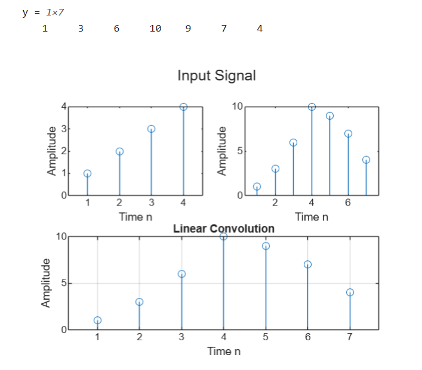
#### Expected Output
```text
Linear Convolution Output:
     1     3     6    10     9     7     4
```
The output contains seven samples because both input signals contain four samples:
$$
L = N + M - 1
$$
$$
L = 4 + 4 - 1 = 7
$$
The output can also be calculated manually:
$$
y[n] = [1,\ 3,\ 6,\ 10,\ 9,\ 7,\ 4]
$$

#### Outcome:
The fundamental concepts of Digital Signal Processing were explored, including signals, systems, Fourier Transform, Z-Transform and linear convolution. The echo example demonstrated why convolution is needed: the output of a system is the combined contribution of input samples over time.

Linear convolution of two four-sample discrete-time signals was successfully implemented using MATLAB. The resulting seven-sample output was `[1, 3, 6, 10, 9, 7, 4]`. This experiment established a practical understanding of convolution and its importance in signal and system analysis.


## Task 9: Whose Array Is It Anyway?
### PROM, PLA, and PAL
In this task I learnt about: Programmable Read-Only Memory (PROM), Programmable Logic Array (PLA), and Programmable Array Logic (PAL) are programmable logic devices used to implement custom digital circuits using interconnected AND and OR gate arrays. 
- PROM features a fixed AND array that acts as a full decoder alongside a programmable OR array, making it ideal for standard memory storage but less efficient for minimized Boolean logic. 
- PLA provides maximum design flexibility by featuring both programmable AND and programmable OR arrays, which allows unique product terms to be shared across multiple outputs to minimize gate count. 
- PAL simplifies this structure by combining a programmable AND array with a fixed OR array, resulting in faster signal propagation and lower manufacturing costs at the expense of product term sharing.

I designed a logic circuit that outputs '1' if the number of 1’s in a 3-bit input (A, B, C) is odd. First I designed this using a PAL and then I designed the same thing using a PLA. I have attached the tables below.
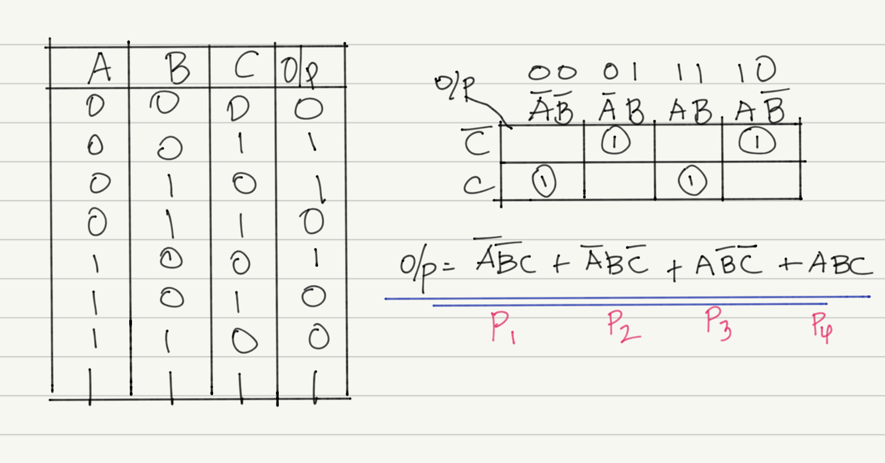
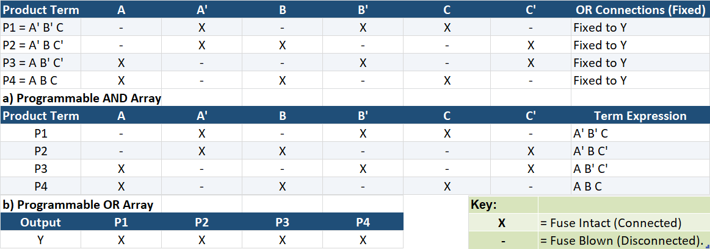
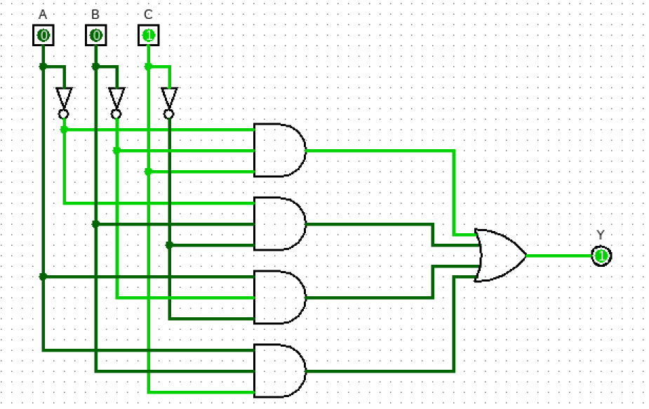

### Smart Home Controller
I applied what I learnt in designing a Smart Home Controller in Logisim that manages three lighting zones ($Y_1, Y_2, Y_3$) using motion, light, time, and override inputs ($M, L, T, O$). By taking advantage of term sharing in the PLA, I routed shared signals like Manual Override ($O$) and Motion at Night ($M \cdot T$) across multiple lights to keep the circuit simple and efficient.

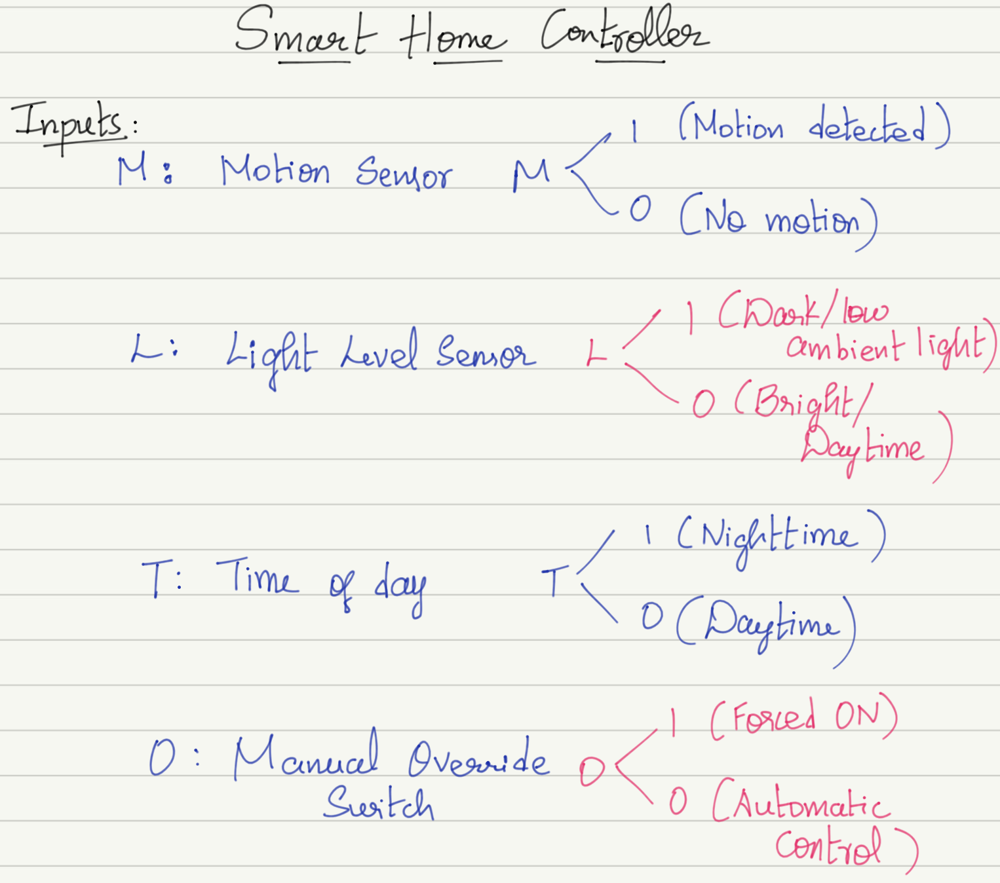
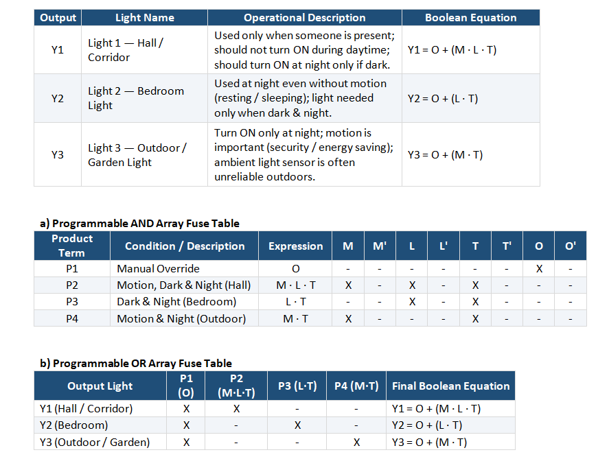
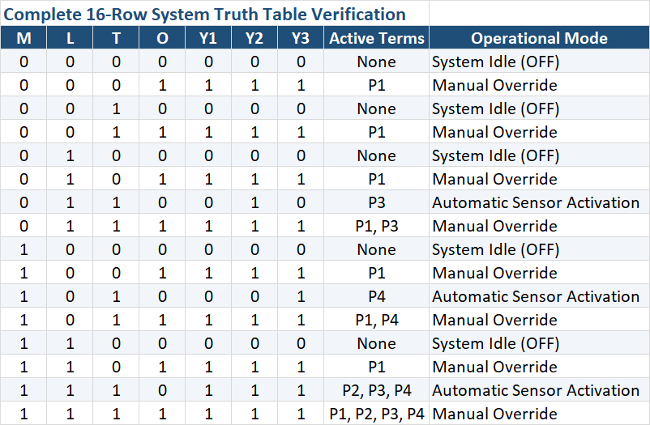
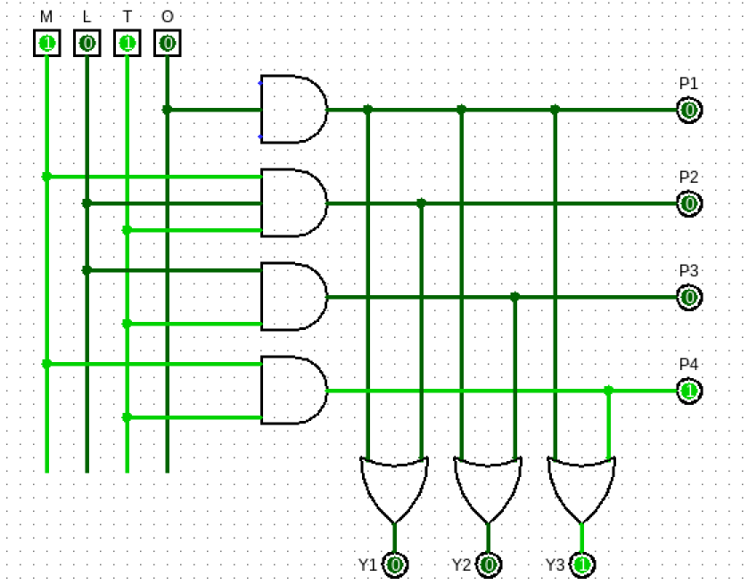


## Task 10: Your Logic, Preloaded
*Objective:*
To understand the concept of Look-Up Tables (LUTs) and to implement a 2-input XOR function using a 4x1 LUT (2 input bits select one of 4 pre-stored outputs).

*Methodology:*
I first read up on Look-Up Tables to understand how they work.
A LUT stores the output of a logic function for every possible input combination, and the inputs simply act as an address that picks the stored value, instead of using logic gates to compute the result.It is widely used in digital systems, FPGAs, signal processing, and computing to implement logic functions, mathematical operations, or complex mappings quickly and efficiently.
I then wrote the truth table for the XOR function manually.

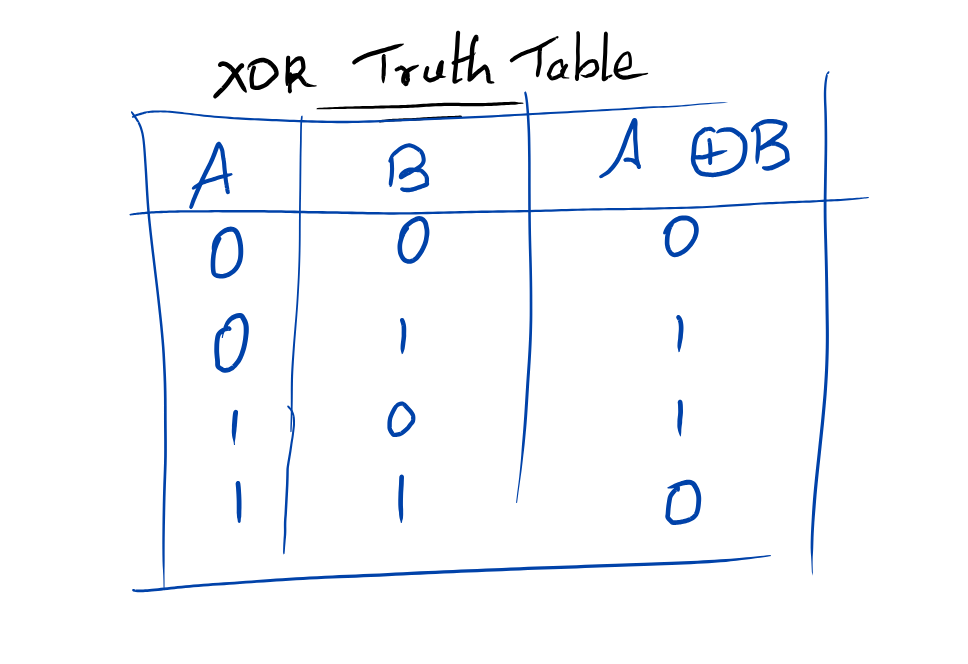

Then, I programmed a 4×1 LUT with the correct outputs based on the truth table.

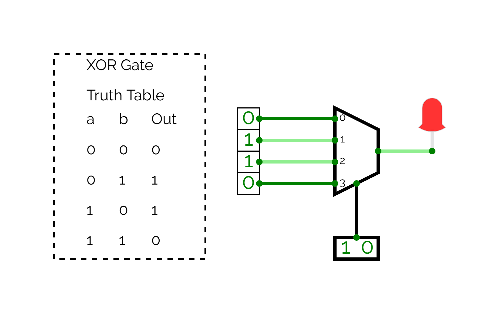

To simulate the circuit, I changed the select inputs through all four combinations (00, 01, 10 and 11). For each combination, the multiplexer picked the matching stored value: the LED stayed OFF for 00 and 11, and turned ON for 01 and 10, which matches the XOR truth table.

*Outcome:*
I learnt what a Look-Up Table is and how it can implement any logic function by storing its truth table, with the inputs acting as the address. I also learnt how a multiplexer can be used as a LUT, and I became more familiar with designing and simulating circuits in CircuitVerse.
